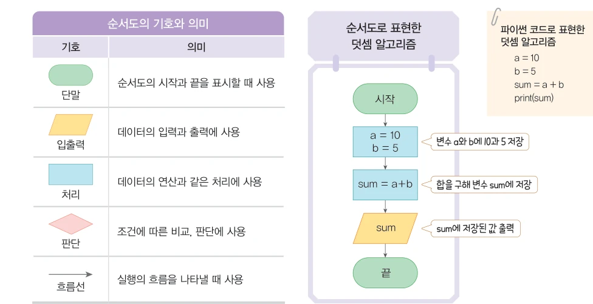

# Info_edu2026 · 정보 복습실

Repository for HBNR middle school student, One time account, Closed Circuit Only.

중학교 1학년 정보 교과서 3단원 ‘알고리즘과 프로그래밍’과 5단원 ‘디지털 문화’의 복습 사이트입니다. 각 단원 하단에서 5문항 연습문제를 풀고, 바로 채점할 수 있습니다.

## 내용 고치기

| 파일 | 여기에서 바꾸는 내용 |
| --- | --- |
| `content/unit-3.md`, `content/unit-5.md` | 단원별 핵심 개념, 설명, 예시, 교과서 삽화 |
| `content/quiz-3.csv`, `content/quiz-5.csv` | 문제, 보기, 정답 번호, 해설 |
| `assets/` | 교과서에서 발췌한 그림 |
| `app.js` 상단 `units` | 단원 이름, 홈 카드의 설명·키워드·이미지 |
| `index.html`, `styles.css`, `app.js` | 화면 구조, 디자인, 채점 및 이동 동작 |

### 개념 설명

소주제 제목을 `## 제목`으로 적으면 목차에 자동으로 추가됩니다. 하위 제목은 `### 제목`, 굵게 써야 할 말은 `**단어**`, 목록은 `- 항목` 또는 `1. 항목`, 강조 상자는 `> 문장`으로 씁니다. 문단 사이는 빈 줄로 나눕니다. 그림을 추가할 때는 파일을 `assets`에 두고 다음처럼 작성합니다. 이미지 줄을 연달아 쓰면 함께 배치됩니다.

```markdown

```

### 연습문제

첫 줄은 그대로 두고 한 행에 한 문항을 씁니다. 정답은 보기 번호(1~4)입니다. OX 문항은 보기1에 O, 보기2에 X를 쓰고 보기3·4는 비워 둡니다. 아래는 한 줄의 예시입니다.

```csv
OX,OR는 두 조건이 모두 참일 때도 참이다.,O,X,,,1,OR는 조건 중 하나 이상이 참이면 참이에요.
```

엑셀에서 편집할 경우 **CSV UTF-8(쉼표로 분리)**로 저장합니다. GitHub에서 직접 편집할 때 쉼표가 들어간 문장 전체를 큰따옴표로 묶고, 문장 속 큰따옴표는 두 번 적습니다. 문제 수는 CSV에 있는 문항 수에 따라 자동으로 표시됩니다.

## 내 컴퓨터에서 미리 보기

압축을 풀고 해당 폴더에서 터미널을 연 뒤 `py -m http.server 8000`(Windows) 또는 `python3 -m http.server 8000`(macOS·Linux)을 실행합니다. 브라우저에서 `http://localhost:8000`을 엽니다. 별도로 받는 미리보기 HTML은 인터넷 연결 없이 브라우저에서 바로 열 수 있는 시연용 파일입니다.

## GitHub와 Vercel에 연결

이 폴더의 파일을 GitHub 저장소의 루트(최상단)에 올리고 Vercel에서 해당 저장소를 가져옵니다. 프레임워크는 Other, 루트 디렉터리는 저장소 루트를 사용합니다. 별도의 설치나 빌드 과정 없이 정적 사이트로 배포되는 설정이 `vercel.json`에 있습니다. 연결한 뒤 운영 브랜치에서 마크다운이나 CSV를 수정해 저장하면 학생용 주소에 반영됩니다.

학생 이름이나 성적은 서버에 전송하지 않습니다. 연습 문제와 정답은 웹사이트 파일에 있어 학생이 스스로 복습하는 용도로 구성되어 있습니다.

삽화는 제공받은 중학교 정보 교과서 3·5단원에서 발췌했습니다. 표시한 쪽수는 책에 인쇄된 쪽수입니다.
